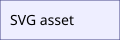

---
mathmd:
  meta:
    language: en
    timezone: UTC
    title: "Phase 3.5 Comprehensive Inspector"
    author: ["MarkTeXset"]
    date: 2026-07-27
  citation:
    style: numeric
  bibliography:
    - phase3-references.bib
  preview:
    math-inspector:
      enabled: true
      open: false
  command:
    macros:
      abs:
        args: 1
        body: "\\left|#1\\right|"
    operators:
      rank:
        text: "rank"
        limits: false
  layout:
    margins: 25mm
    heading:
      numbered: true
      numbering-depth: 3
      toc-depth: 3
      toc: "Contents"
    equation:
      numbered: false
    callouts:
      theorem:
        title: "Theorem {theorem.arabic}."
        style: definition
      proof:
        title: "Proof"
        style: proof
---

<maketitle />
<maketoc />

# CommonMark and cumulative features {#overview .lead}

This cumulative sample includes **strong**, *emphasis*, ~~strike~~, a [URL](https://example.com), a numeric citation [@knuth1984], a task list, and a definition list.

- [x] completed
- [ ] pending

Term
: A definition-list entry.

[^defined]: A footnote definition outside a Callout.

Footnote[^defined] and an unresolved footnote[^missing].

## Equations, source maps, and references

Inline $x^2 + \abs{x} + \operatorname{rank}(A)$ is inspectable.

$$
a & = b && c & = d \label{eq:quadratic} \\
e & = f && g & = h \notag \\
i & = j && k & = l \label{eq:second}
$$

The first equation is [the quadratic equation](#eq:quadratic); the second is [](#eq:second).

```tikzcd
A \arrow[r] & B \\
C & D \arrow[u]
```

## Callouts and nested content

> [!theorem] Pythagoras {#pythagoras .highlight}
> A theorem with inline $a^2+b^2=c^2$.
>
> | a | b |
> |---|---|
> | 3 | 4 |
>
> ```javascript:example.js
> const c = Math.sqrt(a*a + b*b);
> ```
>
> > [!proof] Proof
> > The proof body ends with an automatic QED marker.

## Tables, styles, figures, and controls

<style>
.mathmd-table td:nth-child(2) { text-align: center; vertical-align: middle; border: 2px double #246; }
</style>

| Name | Value |
|---|---:|
| alpha | 1 |
| beta | 2 |

 {#asset}

<pagebreak />
<pagestyle name="plain" />
<references />
