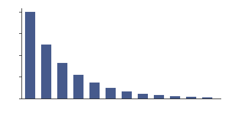

---
mathmd:
  meta:
    language: en
    date: 2026-01-01
---

# Matrix decompositions in practice

A matrix decomposition writes a matrix as a product of factors that are easier to understand or to compute with. Which decomposition is appropriate depends on the structure of the matrix and on the question being asked: solving a linear system, computing eigenvalues, or approximating the matrix by one of lower rank. This section compares the standard decompositions and describes how their costs and guarantees differ in practice.

Table 1 summarizes the decompositions discussed below. The costs are leading-order operation counts for a dense $n \times n$ matrix; in each case the constant matters less than the stability of the algorithm and the structure it preserves.

| Decomposition | Form | Requirements | Cost |
|---|---|---|---:|
| LU | $A = LU$ | nonsingular leading minors | $\tfrac{2}{3}n^3$ |
| Cholesky | $A = R^\top R$ | symmetric positive definite | $\tfrac{1}{3}n^3$ |
| QR | $A = QR$ | none | $\tfrac{4}{3}n^3$ |
| Spectral | $A = Q \Lambda Q^\top$ | symmetric | $9n^3$ |
| SVD | $A = U \Sigma V^\top$ | none | $21n^3$ |

: Standard matrix decompositions and their costs.

The LU decomposition is Gaussian elimination recorded in matrix form. Without pivoting it can fail even for well-conditioned matrices, so in practice one computes $PA = LU$ with a permutation $P$ chosen by partial pivoting. The smallest example is a matrix with a zero in the pivot position, which has no LU decomposition until its rows are exchanged:

$$
\begin{pmatrix} 0 & 1 \\ 1 & 1 \end{pmatrix} = \begin{pmatrix} 0 & 1 \\ 1 & 0 \end{pmatrix} \begin{pmatrix} 1 & 0 \\ 0 & 1 \end{pmatrix} \begin{pmatrix} 1 & 1 \\ 0 & 1 \end{pmatrix}.
$$

 The growth factor of partial pivoting is bounded by $2^{n-1}$, and although this bound is attained by contrived examples, matrices that arise in applications almost never come close to it.[^growth]

## Least squares

Given $A \in \mathbb{R}^{m \times n}$ with $m > n$ and full column rank, the least squares problem asks for the vector $x$ that minimizes $\|Ax - b\|_2$. Writing $A = QR$ with $Q$ having orthonormal columns and $R$ upper triangular, and using the invariance of the Euclidean norm under orthogonal transformations, we obtain

$$
\|Ax - b\|_2^2 = \|Rx - Q^\top b\|_2^2 + \|(I - QQ^\top) b\|_2^2,
$$

so the minimizer solves the triangular system $Rx = Q^\top b$, and the residual norm is the norm of the component of $b$ orthogonal to the range of $A$. Forming the normal equations $A^\top A x = A^\top b$ instead squares the condition number of the problem, which is why the QR approach is preferred whenever accuracy matters.

The method can be summarized in three steps:

1. Compute the decomposition $A = QR$ by Householder reflections, without forming $Q$ explicitly.
2. Apply the reflections to $b$ to obtain $c = Q^\top b$.
3. Solve $Rx = c$ by back substitution.

In a numerical library the whole procedure is a single call. The following fragment solves a least squares problem and checks that the residual is orthogonal to the columns of $A$:

```python
import numpy as np

rng = np.random.default_rng(0)
A = rng.standard_normal((100, 5))
b = rng.standard_normal(100)
x, *_ = np.linalg.lstsq(A, b, rcond=None)
print(np.abs(A.T @ (A @ x - b)).max())
```

## Low-rank approximation

The singular value decomposition orders the information in a matrix by importance. If $A = \sum_{i} \sigma_i u_i v_i^\top$ with $\sigma_1 \ge \sigma_2 \ge \dots \ge 0$, then truncating the sum after $k$ terms gives a matrix $A_k$ of rank $k$, and no matrix of rank at most $k$ is closer to $A$:

$$
\min_{\operatorname{rank} B \le k} \|A - B\|_2 = \|A - A_k\|_2 = \sigma_{k+1}.
$$

How useful this is depends on how quickly the singular values decay. Figure 1 shows a typical example from a smooth kernel matrix, where the singular values fall by roughly a third from one to the next, so that a handful of terms already capture almost all of the matrix.



**Theorem 1.** Let $A \in \mathbb{R}^{m \times n}$ have singular values $\sigma_1 \ge \dots \ge \sigma_p$, where $p = \min(m, n)$. For every $k < p$, the truncated decomposition $A_k$ satisfies $\|A - A_k\|_F^2 = \sum_{i > k} \sigma_i^2$, and no matrix of rank at most $k$ attains a smaller Frobenius distance to $A$.

*Proof.* The Frobenius norm is invariant under orthogonal transformations, so it suffices to consider the case in which $A$ is diagonal. A matrix of rank at most $k$ can reproduce at most $k$ of the diagonal entries, and the error is smallest when it reproduces the $k$ largest ones.[^weyl] $\square$

Randomized algorithms exploit rapid decay directly. Multiplying $A$ by a random matrix with slightly more than $k$ columns produces, with high probability, a basis for a subspace that contains most of the range of $A_k$; a small decomposition of the projected matrix then recovers an approximation whose error is close to $\sigma_{k+1}$. For large sparse matrices this replaces a cost proportional to $mn \min(m, n)$ with one proportional to the cost of a few matrix–vector products.

Table 2 compares the error of the truncated decomposition with that of a randomized approximation of the same rank for the matrix of Figure 1.

| Rank $k$ | $\sigma_{k+1}$ | Truncated SVD | Randomized |
|---:|---:|---:|---:|
| 2 | 0.410 | 0.410 | 0.433 |
| 4 | 0.180 | 0.180 | 0.191 |
| 6 | 0.080 | 0.080 | 0.086 |
| 8 | 0.035 | 0.035 | 0.038 |

: Spectral-norm errors of rank-$k$ approximations.

The randomized errors exceed the optimal ones by less than ten percent, which is typical when the singular values decay geometrically. When they decay slowly, a few steps of subspace iteration restore the accuracy at a modest additional cost.

[^growth]: Wilkinson showed that the growth factor for partial pivoting can reach $2^{n-1}$, but the matrices that do so form a set of very small measure.
[^weyl]: The precise argument uses Weyl's inequality $\sigma_{i+j-1}(A + B) \le \sigma_i(A) + \sigma_j(B)$.
